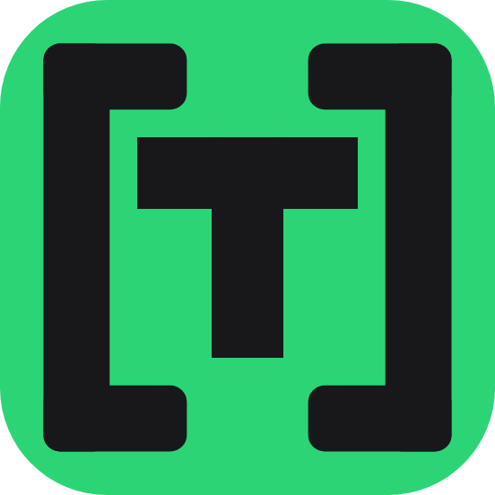

# TQT Labs

**Independent software studio building AI workflow tools.**

Full-stack developer, solo founder. I design, build, and ship small, privacy-first
tools that make everyday AI work faster — and I build in public.

---

### 🚀 What I'm building

- **[ChatBoost](https://chromewebstore.google.com/detail/chatboost/enjnokbmmjlmagklgajdgkohlcapnpoh)** — prompt library & table of contents for ChatGPT · [site](https://chatboost.tqtlabs.com)
- **[ActNow AI Assistant](https://github.com/jinhun-tqtteam/ActNow)** — a floating, model-agnostic AI assistant for any webpage · open source
- **[Session Dashboard](https://github.com/jinhun-tqtteam/dsh-dashboard)** — every DeepSeek Harness session, task & token KPI on one page · open source
- **Etamy** — a context-aware personal AI memory engine · in progress

I also build **AI automation** — agentic workflows and programmatic SEO pipelines on top of Claude, Gemini, and DeepSeek.

---

### 🧰 Stack & Infrastructure

**Core & Automation**

**AI & Models**

**Self-Hosted Infra**

---

### 📡 Build in public

  

---

### 📊 GitHub stats

  
  

Designed, built, and maintained by one person.

